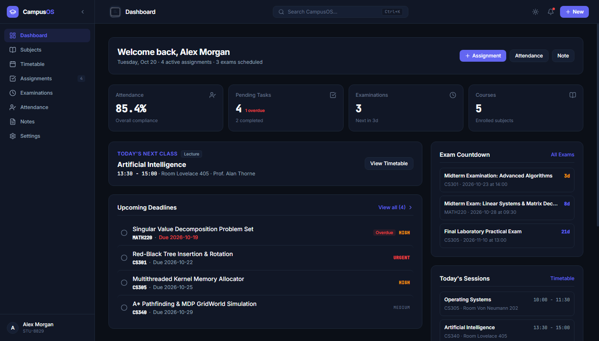
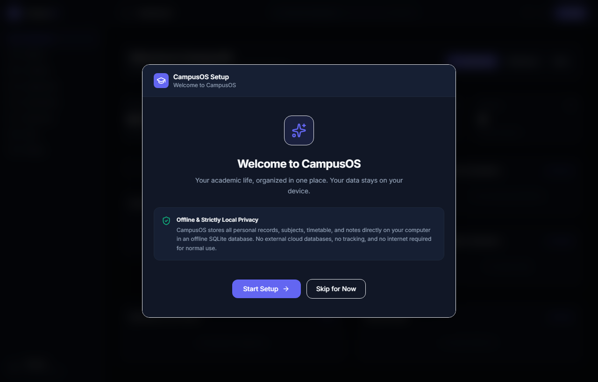
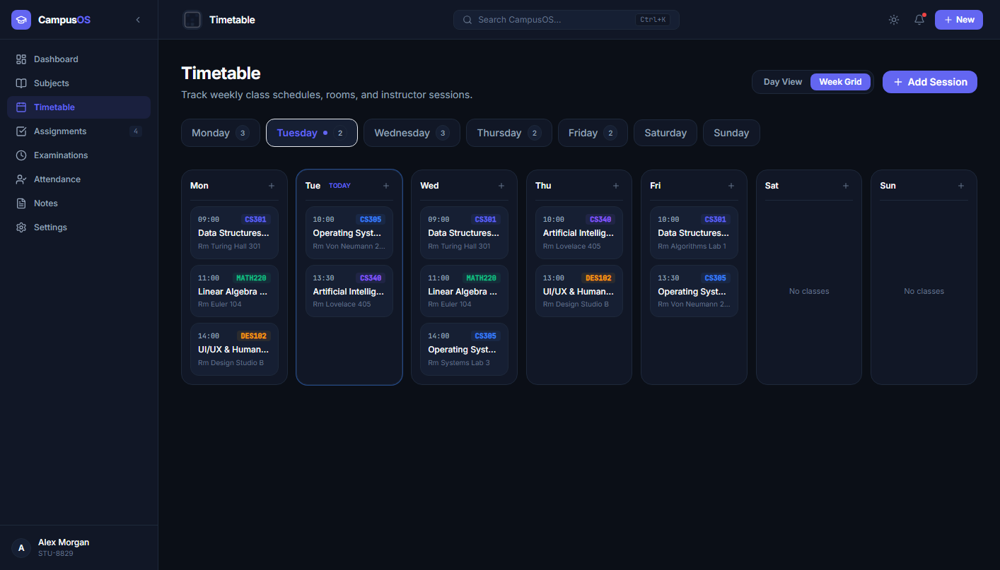
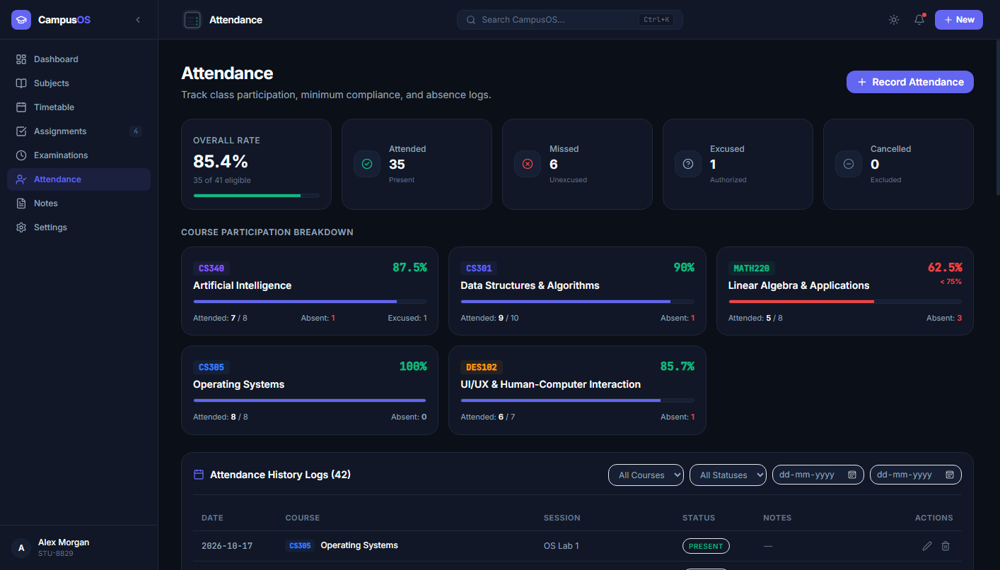
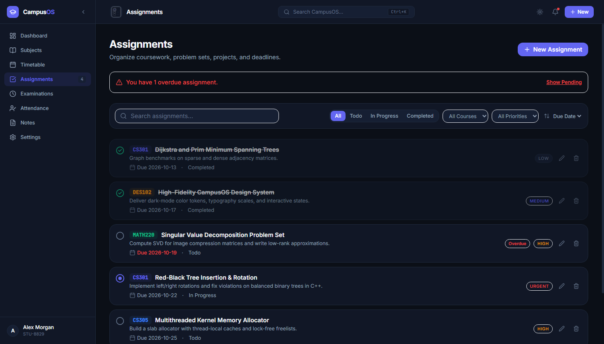
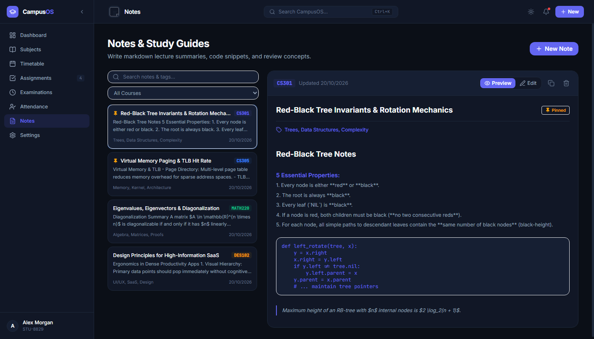

# CampusOS — Local-First Student Life Management Platform

**CampusOS** is a local-first academic operating system designed for college and university students. Licensed under the permissive MIT License, CampusOS is currently preparing for a planned private v1.0.0 release for early users and testers, with public open-source availability planned for general release. It consolidates enrolled courses, timetables, assignment deadlines, exam countdowns, attendance compliance, and lecture notes into a single high-performance desktop workspace.

CampusOS runs locally on your own computer. Core academic records, schedules, and notes are stored on your local machine in an offline SQLite database—without requiring cloud user accounts, paid subscriptions, or external telemetry services.

---

## 🌟 Key Features

- **Centralized Academic Dashboard:** Real-time visibility into today's class schedule, urgent assignment deadlines, upcoming exam dates, and cumulative attendance compliance.
- **Course & Subject Catalog:** Manage enrolled courses with custom color coding, course codes, credit allocations, and instructor contact details.
- **Interactive Timetable:** Day and weekly calendar views featuring conflict and overlap detection to prevent double-booking lecture sessions.
- **Assignment & Deadline Tracker:** Track deliverables across courses with priority indicators (low, medium, high, urgent), completion statuses, and automatic overdue calculations.
- **Exam Countdown & Weightage Tracker:** Stay prepared with days-remaining countdowns, imminent examination alerts (within 3 days), and assessment weightages.
- **Attendance Analytics & Compliance:** Record sessions as *Attended*, *Missed*, *Cancelled*, or *Excused*. Automatically calculates your compliance against an institutional attendance threshold (default: 75%) and computes attendance projection metrics.
- **Markdown Lecture Notes:** Focused lecture notes editor with live split-screen preview, tag organization, and instant search.
- **Command Palette (`Ctrl+K`):** Fast keyboard launcher to quickly search courses, assignments, exams, and notes from anywhere in the app.
- **First-Launch Setup Wizard:** An interactive 4-step onboarding flow that configures your student profile, degree details, enrolled subjects, and attendance goals on first run.
- **Local Data Management:** Export full JSON snapshots of your academic history, restore verified backups with transactional validation, or reset data with explicit double-confirmation.
- **Polished Theme Support:** Modern Dark and Light themes with fluid academic navigation transitions and accessible contrast.

---

## 🖼️ Screenshots

CampusOS features a modern, distraction-free desktop interface built with Tailwind CSS and custom design tokens:

### Central Academic Dashboard

*Real-time overview of current attendance compliance, overdue assignments, upcoming exam countdowns, and today's lecture schedule.*

### First-Launch Onboarding Wizard

*Guided 4-step setup wizard introducing local-first privacy, student identifiers, degree details, and starter subjects.*

### Weekly Timetable Grid

*Interactive multi-day schedule with room locations, instructor assignments, and session conflict detection.*

### Attendance Analytics & Compliance Monitoring

*Overall attendance rate vs. institutional threshold (75%), subject breakdown with warning indicators, and filtered session logs.*

### Assignment & Deliverables Tracker

*Filterable assignment queue with urgency tags, overdue banners, course associations, and completion checkboxes.*

### Markdown Lecture Notes & Study Guides

*Split-view markdown editor with pinned notes, tag filtering, syntax highlighting, and instant full-text search.*

---

## 💻 Technology Stack & Architecture

CampusOS combines a modern web frontend with an embedded local backend sidecar packaged for Windows desktop environments:

| Layer | Technologies |
| :--- | :--- |
| **Frontend Application** | React 19, TypeScript, Vite, Tailwind CSS, Lucide Icons |
| **Backend API Engine** | FastAPI, Python 3.11, Pydantic v2, Uvicorn |
| **Database & Persistence** | SQLite, SQLAlchemy ORM |
| **Primary Desktop Packaging** | PyInstaller (`campusos-backend.exe`), C# / .NET native launcher (`CampusOS.exe`) |
| **Windows Installer** | NSIS (Nullsoft Scriptable Install System) generating `CampusOS_1.0.0_Setup.exe` |
| **Auxiliary Desktop Config** | Tauri 2 (`frontend/src-tauri/`) maintained as an auxiliary cross-platform experiment and icon source; not used for the production Windows release installer |
| **Automated Testing** | pytest (backend: 34 tests), Vitest & Testing Library (frontend: 35 tests) |

### Supported Windows Architecture
The production Windows release operates through coordinated, decoupled local components:
1. **Native C# Launcher (`CampusOS.exe`):** A lightweight Windows launcher (`launcher/Program.cs` compiled with .NET `csc.exe`). On startup, it discovers an available local port starting at 18420 (or dynamically selects an ephemeral loopback port), starts the backend sidecar process in the background, continuously polls `/api/health` until the API is ready, and displays the interface in a dedicated, chromeless application window using Microsoft Edge application mode (`--app=http://127.0.0.1:<port>`), with fallback to the default system browser if needed.
2. **Standalone Backend Executable (`campusos-backend.exe`):** PyInstaller packages the FastAPI application (`backend/desktop_entry.py`) along with the embedded frontend static build (`frontend/dist`) into a single executable. It serves both the local REST API and the static web assets strictly over local loopback (`127.0.0.1`).
3. **Local SQLite Database (`campusos.db`):** Zero-configuration database stored in the user's roaming application directory (`%APPDATA%\CampusOS\campusos.db`).
4. **NSIS Installer (`CampusOS_1.0.0_Setup.exe`):** Assembled via `installer/CampusOS.nsi`, bundling the launcher, backend binary, icons, and dependencies into a standard Windows installer with Start Menu shortcuts and a clean uninstaller.
5. **Auxiliary Tauri Experiment:** While `frontend/src-tauri` is preserved in the repository as an auxiliary exploration target for future cross-platform builds, it is not the active desktop release engine. The shipped, verified v1.0.0 installer uses the C# launcher and PyInstaller NSIS pipeline.

---

## 📦 Installation (Windows)

CampusOS is packaged as a standalone Windows desktop application. End users **do not need** to install Python, Node.js, or external database software.

### Obtaining the Installer:
- During the initial private v1.0.0 release, the installer is available only to authorized recipients and project participants once finalized.
- The expected installer filename for the planned v1.0.0 release is:
  ```
  CampusOS_1.0.0_Setup.exe
  ```
- The CampusOS installer will become publicly downloadable only when the project reaches its public launch and the repository is made public. In the interim, authorized developers can compile the application and installer locally from source using the instructions below.

### Step-by-Step Installation:
1. Once received as an authorized recipient (or after compiling locally from source), locate `CampusOS_1.0.0_Setup.exe`.
2. Double-click `CampusOS_1.0.0_Setup.exe` to run the setup wizard.
   - *Note:* If Windows Defender SmartScreen displays an alert ("Windows protected your PC"), click **More info** followed by **Run anyway**. This prompt appears for newly compiled software that has not yet established Microsoft reputation or acquired a commercial code-signing certificate.
3. Follow the setup prompts to choose your destination directory (defaults to `%LOCALAPPDATA%\Programs\CampusOS`).
4. Once installation completes, launch **CampusOS** from your Desktop shortcut or Start Menu.

---

## 🎓 First-Launch Setup & Usage

When opening CampusOS for the first time without an existing profile, the **CampusOS Setup Wizard** guides you through initial setup:

1. **Welcome Screen:** Overview of the application and confirmation of local-first privacy. Click **Start Setup** to begin, or **Skip for Now** to enter the empty dashboard directly.
2. **Personal Profile (Step 1):** Enter your Full Name (used to personalize greetings) and optional identifiers such as Roll Number, Register Number, or Student Email.
3. **Academic Profile (Step 2):** Enter your University or Institution name, Degree (e.g., B.Tech, B.S., M.S.), Department/Major, Admission Year, Current Academic Year, and Current Semester.
4. **Academic Setup (Step 3):**
   - Adjust your minimum **Attendance Target** slider (defaults to 75%).
   - Quickly enroll your initial subjects (course name, code, credits, instructor).
   - Optionally schedule your first upcoming assignment deadline and examination date.
5. **Review & Finish (Step 4):** Review your profile summary and click **Finish Setup**. Your profile and subjects are saved into the local database, routing directly into your active dashboard.

You can modify profile details, add courses, or configure preferences at any time from the **Subjects** and **Settings** pages.

---

## 🔒 Data Storage & Privacy

CampusOS is built around a local-first operational model:

1. **Local Database Storage:** All profile details, enrolled courses, timetable entries, assignments, exams, attendance logs, and lecture notes are stored on your local drive in an SQLite database:
   - **Installed Windows Application:** `%APPDATA%\CampusOS\campusos.db` (typically `C:\Users\<YourUsername>\AppData\Roaming\CampusOS\campusos.db`, or overridden by the `CAMPUSOS_DATA_DIR` environment variable).
   - **Local Development Environment:**  
     `./campusos.db` *(within the repository root, or specified via `DATABASE_URL`)*.
2. **Local Loopback Network Communication:** The desktop backend sidecar binds strictly to loopback (`127.0.0.1`). During launch, the system automatically searches for an available port starting at port 18420 (or dynamically assigns an ephemeral port) to avoid conflicting with existing services. The application does not accept inbound connections from external networks.
3. **Offline Operation:** The application does not require external cloud authentication, telemetry, or cloud database synchronization for its core features.
4. **Data Backup & Portability:**
   - Under **Settings > Data Management**, you can export a JSON backup file (`campusos_backup_*.json`) containing your complete academic records.
   - Backups can be restored with transactional schema validation that verifies records before committing changes.
5. **Security Notice:** Data in the local SQLite database is stored unencrypted at rest on your hard drive. Standard operating system security measures (such as user account passwords and full-disk encryption like Windows BitLocker) are recommended to safeguard your files against unauthorized local access.

---

## 🖥️ System Requirements

- **Operating System:** Windows 10 (64-bit) or Windows 11 (64-bit).
- **RAM:** 2 GB minimum (4 GB recommended).
- **Disk Space:** Approximately 100 MB for installation and local application data.
- **Webview Engine:** Microsoft Edge browser or Microsoft Edge WebView2 runtime (pre-installed on modern Windows 10 and 11 systems).
- **External Dependencies:** None required for the packaged installer.

---

## 🛠️ Developer Setup & Local Development

To contribute to CampusOS or run it directly from source code:

> **Repository Access Note:** While preparing for the planned private v1.0.0 release, access to the repository requires authorized GitHub account membership. Public cloning will be enabled upon public launch.

### Prerequisites
- **Python:** 3.11 or higher
- **Node.js:** 22.x or higher (`npm` 10+)
- **Git**

### 1. Clone the Repository
```powershell
git clone https://github.com/samdroz/CampusOS.git
cd CampusOS
```

### 2. Configure Backend Environment
```powershell
# Create and activate Python virtual environment
python -m venv .venv
.\.venv\Scripts\Activate.ps1

# Install backend dependencies
pip install -r backend/requirements.txt
```

### 3. Configure Frontend Environment
From the repository root, install frontend dependencies without altering your working directory:
```powershell
npm --prefix frontend install
```
*(Alternatively: `cd frontend; npm install; cd ..`)*

### 4. Running the Development Servers
Open two terminal windows:

**Terminal 1 — Backend API (FastAPI):**
```powershell
.\.venv\Scripts\Activate.ps1
$env:PYTHONPATH="."
python -m uvicorn backend.app.main:app --host 127.0.0.1 --port 8000 --reload
```
Interactive API documentation will be available at `http://127.0.0.1:8000/docs`.

**Terminal 2 — Frontend Dev Server (Vite):**
```powershell
cd frontend
npm run dev
```
Open `http://localhost:5173` in your browser.

### 5. Running the Local Desktop App Directly
To launch the desktop application locally without running individual dev servers:
```powershell
.\launch_desktop.ps1
```
*(Or use `launch_desktop.bat` from Command Prompt).*

---

## 🏗️ Building the Windows Desktop Installer

To compile the standalone Windows installer locally:

### Build Prerequisites:
- Python 3.11 with `pyinstaller` installed in your virtual environment.
- Node.js 22+ and npm.
- Microsoft .NET Framework (includes `csc.exe` for the launcher).
- NSIS 3.x (`makensis.exe`) installed on your system.

### Build Command:
From the repository root:
```powershell
powershell -ExecutionPolicy Bypass -File .\build_desktop.ps1
```
*(Or run `.\build_desktop.bat` from Command Prompt).*

### Build Outputs (in `dist/`):
- `dist\CampusOS_1.0.0_Setup.exe` — The full NSIS standalone installer.
- `dist\CampusOS.exe` — The native Windows launcher executable.
- `dist\campusos-backend.exe` — Standalone backend executable with embedded static frontend.

---

## 🧪 Automated Testing

CampusOS includes comprehensive automated test suites for both frontend and backend components.

### Running Backend Tests
From the repository root:
```powershell
$env:PYTHONPATH="."
.\.venv\Scripts\python.exe -m pytest backend/tests/ -v
```
*Executes 34 automated tests verifying:*
- Health check endpoints, dynamic port negotiation, and version resolution.
- Subject, session, timetable, assignment, exam, attendance, and notes CRUD operations.
- Schedule overlap detection and attendance compliance calculations.
- First-launch student profile creation, onboarding completion, skip behavior, and debug event logging.
- Database persistence across restarts and transactional JSON backup/restore.

### Running Frontend Tests
From the repository root:
```powershell
npm --prefix frontend test
```
*(Or run `npm test` from within the `frontend/` directory).*

*Executes 35 automated tests in Vitest verifying:*
- Backend discovery, readiness polling with bounded 10-second overall deadline, and connection error handling.
- Onboarding modal rendering and multi-step wizard navigation.
- Subject creation, exam input, and attendance slider validations.
- Theme switching, command palette hotkey (`Ctrl+K`), and keyboard accessibility.
- Empty states, toast notifications, and confirm dialog behavior.

---

## 🚀 Release Workflow (GitHub Actions)

The repository includes a verified CI/CD release workflow at `.github/workflows/release.yml`:

- **Tag-Triggered Publication:** When a version tag matching `v*` (e.g. `v1.0.0`) is pushed to GitHub (`git tag v1.0.0 && git push origin v1.0.0`), the workflow runs on `windows-latest`:
  1. Resolves the release version from the tag and stamps it into `backend/app/version.py`.
  2. Installs Node.js and Python dependencies.
  3. Runs backend (34 tests) and frontend (35 tests) automated test suites.
  4. Builds the frontend production bundle and packages the backend executable via PyInstaller.
  5. Compiles the native launcher with `csc.exe` and packages the installer via NSIS (`dist\CampusOS_<version>_Setup.exe`).
  6. Validates the generated installer artifact existence and non-zero file size.
  7. Publishes a GitHub Release (`draft: false`) with the exact compiled installer attached.
- **Manual Dispatches & Main Branch Pushes:** When triggered via push to `main` or manual `workflow_dispatch`, the workflow runs the test and compilation steps with default development versioning to verify build integrity without creating a release.

---

## 📁 Project Structure

```
CAMPUSOS/
├── .github/
│   └── workflows/
│       └── release.yml          # GitHub Actions CI/CD release workflow
├── backend/
│   ├── app/
│   │   ├── api/                 # FastAPI route handlers (subjects, profile, etc.)
│   │   ├── core/                # Database config & AppData path resolution
│   │   ├── models/              # SQLAlchemy database models
│   │   ├── schemas/             # Pydantic validation schemas
│   │   ├── services/            # Business logic (attendance, timetable, backup)
│   │   ├── version.py           # Release version stamping module
│   │   └── main.py              # Application entrypoint & static mounting
│   ├── tests/
│   │   └── test_backend.py      # Automated pytest suite (34 tests)
│   ├── desktop_entry.py         # PyInstaller desktop sidecar launcher
│   └── requirements.txt         # Python dependencies
├── docs/
│   └── screenshots/             # Genuine application UI screenshots
│       ├── dashboard.png        # Academic dashboard overview
│       ├── welcome.png          # First-launch setup wizard
│       ├── timetable.png        # Weekly timetable schedule
│       ├── attendance.png       # Attendance compliance tracking
│       ├── assignments.png      # Assignment deliverables queue
│       └── notes.png            # Markdown lecture notes editor
├── frontend/
│   ├── src/
│   │   ├── api/                 # Type-safe API client & port resolution
│   │   ├── components/          # Reusable UI components & modals
│   │   ├── pages/               # Feature pages (Dashboard, Timetable, etc.)
│   │   ├── tests/               # Vitest frontend test suite (35 tests)
│   │   ├── types/               # TypeScript domain interfaces
│   │   ├── App.tsx              # Root application container & navigation
│   │   └── main.tsx             # React DOM mounting
│   ├── src-tauri/               # Auxiliary Tauri 2 configuration and icons
│   ├── package.json             # Frontend dependencies & build scripts
│   └── vite.config.ts           # Vite bundler configuration
├── installer/
│   └── CampusOS.nsi             # NSIS installer definition script
├── launcher/
│   └── Program.cs               # C# .NET native Windows desktop launcher
├── build_desktop.ps1            # Standalone desktop build script (PowerShell)
├── build_desktop.bat            # Standalone desktop build script (Batch)
├── launch_desktop.ps1           # Desktop launch script (PowerShell)
├── launch_desktop.bat           # Desktop launch script (Batch)
├── LICENSE                      # MIT License
└── README.md                    # Project documentation
```

---

## 🔧 Troubleshooting

| Issue | Cause | Solution |
| :--- | :--- | :--- |
| **SmartScreen warning during install** | Installer is freshly compiled and not signed with a commercial EV certificate. | Click **More info** and select **Run anyway**. The installer is cleanly built from local source code. |
| **Port conflict on startup** | Port 18420 is in use by another local application. | CampusOS automatically tests and binds to the next available ephemeral port on `127.0.0.1`. No user action needed. |
| **Startup handshake timeout** | Backend sidecar was delayed starting or blocked by security software. | Inspect `%APPDATA%\CampusOS\logs\backend.log` and `%APPDATA%\CampusOS\logs\onboarding-debug.log` for error details. Ensure `campusos-backend.exe` is permitted to run locally. |
| **Accidental data loss or corruption** | Hard drive failure or accidental file modification. | Use **Settings > Data Management > Export Data Backup** regularly to store JSON snapshots. Backups can be restored at any time. |
| **Restoring default state** | You want a completely clean slate. | Open **Settings**, scroll to **Data Management**, and select **Reset Local Data** (requires typing `RESET` to confirm). |

---

## 📄 License & Contributions

CampusOS is licensed under the permissive **MIT License**. See the [LICENSE](LICENSE) file for complete details.

During preparation for the planned private v1.0.0 release, repository access and development are restricted to authorized project participants. Contributions, bug reports, and feature requests will be warmly welcomed from the wider community upon the upcoming public release!

---

## ⚖️ Disclaimer

CampusOS is an independent student productivity application. It is not affiliated with, endorsed by, or sponsored by any university, college, educational institution, or commercial software provider. All academic data entered into the application remains solely the property and responsibility of the user.
